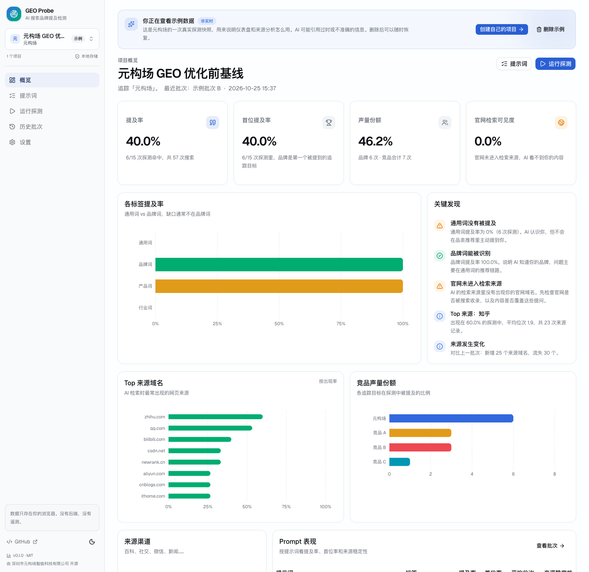
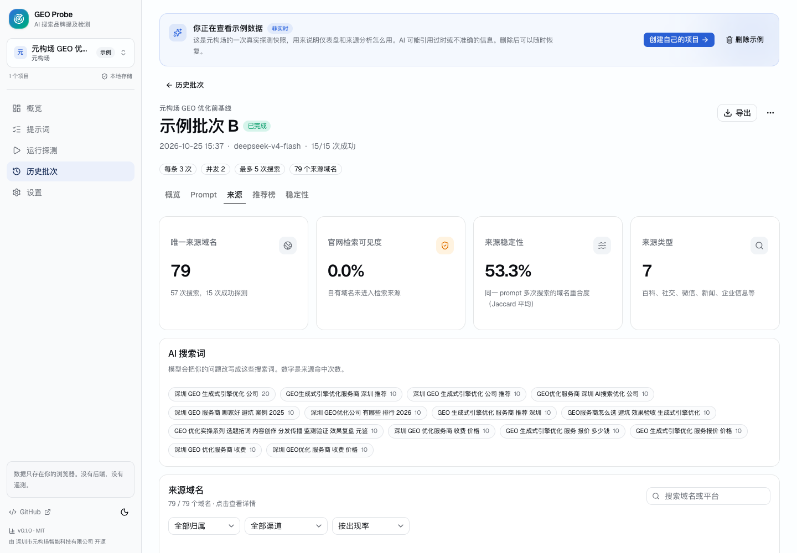
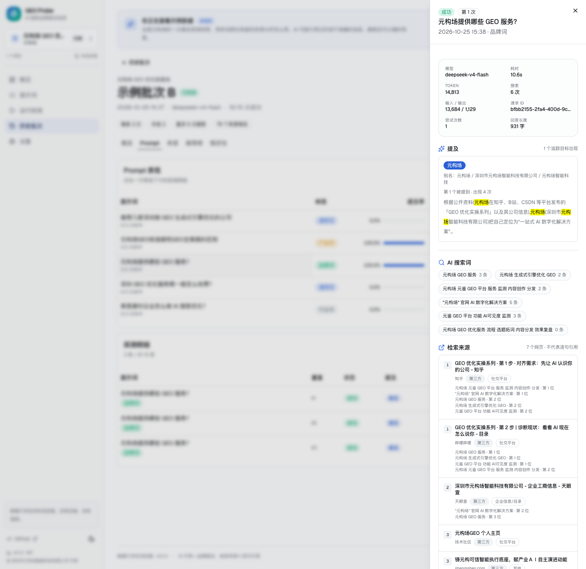

# GEO Probe

**你的品牌，被 AI 提到了吗？**

开源的 GEO（生成式引擎优化）品牌提及检测工具。批量向 DeepSeek 提问，检测 AI 回答里有没有出现你的公司/产品名，追踪竞品声量、检索来源和官网可见度。

纯静态 · 无后端 · 数据只存浏览器 · MIT

[](LICENSE)
[](https://nextjs.org)
[](https://api-docs.deepseek.com)
[](CONTRIBUTING.md)

[在线演示](https://geo-probe.youerning.top) · [快速开始](#快速开始) · [部署](#部署) · [English quickstart](#english-quickstart)



> 演示站内置一份元构场的真实探测快照，**不填 API Key 也能看完整仪表盘**。真实探测才需要你自己的 Key。

---

## 为什么做这个

GEO 从业者每天在 DeepSeek、豆包、元宝里手动新建会话、复制回答、数竞品出现了几次。这个过程不可复现、不可批量、也留不下来源数据。

GEO Probe 把这套动作变成：

1. 配置品牌、别名、官网域名、竞品；
2. 批量跑 10–20 条真实用户会问的问题，每条重复 3 次；
3. 自动判断 AI 有没有提到你、排第几、提到了谁、检索了哪些网页；
4. 把回答、来源、指标全部存在本地，可导出、可对比。

**它不承诺“优化效果”**。它只负责把 AI 当前的回答和来源记录下来，让优化有基线、有证据。

## 功能

- **批量提问**：一个批次跑几十次，不用在 App 里反复新建会话。
- **品牌 + 竞品提及**：公司全称、简称、产品名、英文名、域名都可以做别名；自动算提及率、首位率、平均位次、榜单位次、声量份额。
- **检索来源分析**：记录每次搜索词、来源 URL、位次；按域名/平台聚合，统计出现率、平均位次、渠道结构。
- **官网可见度**：自有域名是否出现在检索来源里，最佳位次是多少。
- **来源稳定性**：同一问题多次提问，来源域名重合度多少。AI 搜索本身不稳定，单次结果别当真。
- **新增/流失来源**：和上一批次对比，哪些域名新进来、哪些丢了。
- **回答链接**：把 AI 回答里显式写出的 URL 抓出来，标记是否在检索来源中。
- **推荐榜**：从回答的编号/列表里解析“第几家推荐了你”，以及 AI 还推荐了哪些未追踪公司。
- **本地优先**：项目、提示词、批次、回答、来源全部在浏览器 IndexedDB；API Key 不进导出、不进仓库。
- **一键静态部署**：`out/` 可以放到 Cloudflare Workers/Pages、Vercel、GitHub Pages、Netlify 或任意静态服务器。





## 快速开始

需要 Node.js 20+ 和 pnpm。

```bash
pnpm install
pnpm dev
```

打开 `http://localhost:3000`：

1. 点「先看示例数据」可以先浏览完整仪表盘；
2. 或者「创建第一个项目」，填品牌、别名、官网域名、竞品；
3. 去「提示词」添加 10–20 条问题；
4. 去「设置」填 DeepSeek API Key；
5. 去「运行探测」，选提示词，开始跑。

默认模型是 `deepseek-v4-flash`，每条重复 3 次，并发 2。运行前会显示预计探测次数、费用和耗时。

## 部署

应用是 Next.js 静态导出，没有服务端依赖。

| 平台 | 做法 |
| --- | --- |
| **Cloudflare Workers** | 连接仓库；Build command `pnpm build`，Deploy command `npx wrangler deploy`；仓库内 `wrangler.jsonc` 已把 `out/` 声明为静态资源。 |
| **Cloudflare Pages** | 连接仓库；构建命令 `pnpm build`，输出目录 `out`，Node 22；绑定自定义域名即可。`public/_headers` 会自动生效。 |
| **Vercel** | 导入仓库，框架选 Next.js，无需环境变量。`vercel.json` 已带安全头。 |
| **GitHub Pages** | 仓库 Settings → Pages → Source 选 GitHub Actions；手动运行 `Deploy to GitHub Pages` workflow（已处理 `basePath`）。 |
| **任意静态服务器** | `pnpm build` 后把 `out/` 传上去。需要把 `/xxx` 映射到 `/xxx/index.html`（项目已开 `trailingSlash`）。 |

### Cloudflare Workers（静态资源）详细步骤

1. Cloudflare Dashboard → Workers & Pages → Create → Workers → Connect to Git；
2. 选择 `youerning/geo-probe`；
3. Build command：`pnpm build`；Deploy command：`npx wrangler deploy`；
4. Root directory 保持仓库根目录，不需要环境变量；
5. 仓库里的 `wrangler.jsonc` 已声明 `assets.directory = "./out"`，`public/_headers` 会随构建复制到 `out/`；
6. 部署完成后在 Worker → Settings → Domains & Routes 绑定 `geo-probe.youerning.top`。

> 本项目是纯静态导出，**不要**运行 `@opennextjs/cloudflare migrate`，也不要把 `next.config.ts` 的 `output` 改成 `standalone`。Cloudflare 的 Next.js 自动迁移会按 SSR 构建，去找 `.next/standalone/.../pages-manifest.json`，这个项目不会生成该文件。

### Cloudflare Pages（备选）

1. Cloudflare Dashboard → Workers & Pages → Create → Pages → Connect to Git；
2. 选择 `youerning/geo-probe`；
3. Framework preset 选 **Next.js (Static HTML Export)**；
4. Build command：`pnpm build`；Build output directory：`out`；
5. 环境变量加 `NODE_VERSION=22`（可选）；
6. 部署完成后在 Custom domains 里绑定 `geo-probe.youerning.top`。

### 隐藏 API Key（可选代理）

默认是访客自带 Key（BYOK）。如果你想让公开演示站真实可跑，又不想暴露 Key，可以部署一个最小 Cloudflare Worker 代理：

见 [`examples/cloudflare-worker-proxy`](examples/cloudflare-worker-proxy/README.md)。

然后在设置 → 自定义 API 地址填入 Worker 地址，Key 留空即可。**公开代理请务必加限流/鉴权**，否则任何人知道地址都能消耗你的余额。

## 它怎么工作

```text
Prompt
  → DeepSeek Anthropic 兼容端点 /anthropic/v1/messages
    → 服务端工具 web_search_20250305
      → 搜索词 + 检索来源（title / URL / 位次）
    → 最终回答 text
  → 品牌/竞品别名匹配
  → 检索来源规范化 + 域名/渠道/归属分类
  → 本地 IndexedDB
  → 仪表盘 / 来源分析 / 推荐榜 / 导出
```

关键实现选择：

- 用 Anthropic 兼容端点而不是 OpenAI Responses 端点，因为实测前者的 `web_search_tool_result` 能拿到来源 URL；后者的 `annotations` 为空。
- 默认 `deepseek-v4-flash`。DeepSeek 文档写 `web_search` 只支持 `deepseek-v4-pro`，但 Anthropic 端点实测 Flash 可用；设置里可切 Pro。
- 严格区分三件事：**Mention（回答里提到品牌）**、**Retrieved Source（搜索工具返回的网页）**、**Answer Link（回答里显式写的 URL）**。三者不是一回事。

更多设计记录见 [`CONTEXT.md`](CONTEXT.md) 和 [`docs/adr`](docs/adr)。

## 指标口径

| 指标 | 定义 |
| --- | --- |
| 提及率 | 出现品牌 Mention 的 Probe 数 ÷ 成功 Probe 数 |
| 首位提及率 | 品牌是回答中第一个被提到的 Target 的 Probe 数 ÷ 成功 Probe 数 |
| 平均位次 | 品牌首次出现时，在追踪 Targets 里的顺序（1 = 第一个） |
| 榜单位次 | 从编号/列表解析出的推荐位次（自动解析，仅供参考） |
| 声量份额 SoV | 品牌 Mention 的 Probe 数 ÷ 所有 Target Mention 的 Probe 数之和 |
| 来源出现率 | 某域名出现在多少比例的 Probe 里 |
| 来源稳定性 | 同一 Prompt 多次 Probe 的来源域名集合两两 Jaccard 平均 |
| 官网检索可见度 | 检索来源中出现品牌自有域名的 Probe 数 ÷ 成功 Probe 数 |

**“引用”在本项目里 = 品牌提及（Mention），不是网页 citation。** 来源列表只代表 AI 搜到了这些网页，不代表模型逐句引用了它们。

## 一个真实基线

我们用元构场自己跑了一组示例数据（就是演示站里的那份）：

- 通用词（“推荐几家深圳做 GEO 优化的公司”）：**0% 提及**
- 品牌词（“元构场提供哪些 GEO 服务”）：**100% 提及**
- 官网域名进入检索来源：**0%**
- 整体提及率：**40%**

这不是为了证明“我们做得好”，而是说明一个常见问题：**AI 认识你，不等于 AI 会推荐你。** 通用词的内容缺口、官网抓取问题，才是 GEO 要解决的地方。

## 隐私

- 没有后端，没有遥测，没有第三方统计脚本。
- API Key 只保存在浏览器 `localStorage`（可选仅 `sessionStorage`），并直接发送给 DeepSeek。
- 项目、提示词、回答、来源全部在浏览器 IndexedDB。
- 导出的 JSON/CSV 包含完整回答和来源，可能含第三方内容；**API Key 永远不会被导出**。
- 如果配置了自定义代理，请求会经过代理；请自行评估代理的可信度。

## 已知限制

- 结果由 AI 实时生成，同一问题多次提问会不同；默认每条跑 3 次就是为了看波动。
- 本项目不是 DeepSeek 官方产品，不受 DeepSeek 背书。
- 探测使用中性的 system prompt，不是 DeepSeek App 的内部提示词；结果不应等同于 App 的官方行为。
- `web_search` 返回的是检索来源，不是逐句引用；没有 sentence-level citation 映射。
- 来源标题/URL 由 DeepSeek 搜索返回，可能缺失、过期或被墙；本项目不做页面正文抓取。
- 榜单解析是启发式的，只对编号/项目符号列表有效；以完整回答为准。
- v1 只支持 DeepSeek。豆包、千问、元宝的 API 能力不同，适配层用 capability flags 建模，后续再加。
- 浏览器直连 DeepSeek 需要 CORS；目前实测可用，但未来可能变化。自定义代理是兜底方案。
- 示例数据是真实 AI 回答的快照，里面的价格、套餐、公司信息可能来自过时页面；以官方最新信息为准。

## Roadmap

- [ ] 豆包 / 千问 / 元宝 Provider
- [ ] 来源摘要 / authority 增强（调 `/v1/tools/search`）
- [ ] 来源页面健康检查（404 / 重定向）
- [ ] 情感与描述准确性分析
- [ ] 定时任务 / 趋势对比
- [ ] 英文 UI
- [ ] 更细的榜单解析（表格、嵌套列表）

## 开发

```bash
pnpm dev          # 开发
pnpm build        # 静态导出到 out/
pnpm lint         # ESLint
pnpm typecheck    # tsc --noEmit
pnpm test         # Vitest
pnpm demo:generate # 重新生成示例数据（需要 .env 里的 DEEPSEEK_API_KEY）
```

目录：

```text
app/                 Next.js 页面（静态导出）
components/          UI、图表、抽屉、表单
lib/analysis/        提及匹配、来源规范化、指标计算
lib/providers/       DeepSeek 适配器
lib/db/              Dexie / IndexedDB
lib/export/          JSON / CSV / Markdown
lib/demo/            示例数据种子
scripts/             示例数据生成
examples/            Cloudflare Worker 代理示例
public/demo/         示例数据 JSON
docs/adr/            架构决策记录
```

示例数据生成：

```bash
cp .env.example .env
# 填入 DEEPSEEK_API_KEY
pnpm demo:generate
```

> 生成示例数据会真实调用 DeepSeek，约 30 次探测、$0.3 左右。生成后请检查回答里是否含个人信息或敏感内容，再提交。

## 贡献

欢迎 Issue 和 PR。请先读 [`CONTRIBUTING.md`](CONTRIBUTING.md) 和 [`CONTEXT.md`](CONTEXT.md)。安全相关问题见 [`SECURITY.md`](SECURITY.md)。

## License

[MIT](LICENSE) © 2026 youer

由 [深圳市元构场智能科技有限公司](https://www.yuangouchang.com) 开源。

---

## English quickstart

GEO Probe is a static, local-first GEO (Generative Engine Optimization) brand-mention probe. It asks DeepSeek a batch of real user questions, detects whether your company/product is mentioned, tracks competitor share of voice, and records the web sources the model retrieved.

```bash
pnpm install
pnpm dev
```

Open `http://localhost:3000`, load the demo data (no API key needed), or create a project and add your DeepSeek API key in Settings.

Deploy the static `out/` folder anywhere: Cloudflare Workers/Pages, Vercel, GitHub Pages, Netlify, or any static host.

**Important**: “citation” in this project means **brand mention in the answer**, not a sentence-level web citation. Retrieved sources are shown separately from answer links. Results vary between runs; the default is 3 repeats per prompt.

MIT licensed. Built by [Yuangouchang](https://www.yuangouchang.com).
